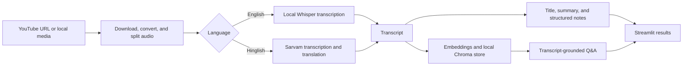

# Frame Notes

**Turn long recordings into clear meeting notes.**

Frame Notes is a meeting-intelligence app I’m shaping into a portfolio project. Give it a YouTube link or a local audio/video file and it creates a transcript, a concise summary, action items, decisions, and follow-up questions. You can then ask questions about the transcript in a chat grounded in the recording.

I designed the app around a simple idea: meeting notes should help people decide what to do next, not make them read another wall of text.

## What it does

- Accepts a YouTube URL or a path to a local media file.
- Downloads audio from YouTube and converts and splits audio for transcription.
- Transcribes English locally with OpenAI Whisper.
- Offers a Hinglish transcription path through Sarvam AI, which returns English text.
- Generates a meeting title, summary, action items, key decisions, and open questions with a configurable language model.
- Builds a local Chroma vector store from the transcript so follow-up questions can retrieve relevant passages.
- Presents the results in a custom Streamlit interface, with a warm dark palette and distinct type styles.

## How it works



The summarization and extraction chains use LangChain. For question answering, the transcript is split into smaller passages, embedded with `all-MiniLM-L6-v2`, and stored in Chroma. The retriever selects relevant passages to provide as context for each question.

## Tech stack

| Area | Tools |
| --- | --- |
| Interface | Python, Streamlit, custom CSS |
| YouTube and media handling | yt-dlp, FFmpeg, pydub |
| English speech recognition | OpenAI Whisper, PyTorch |
| Hinglish speech recognition | Sarvam AI API |
| LLM workflows | LangChain, Mistral, Groq, or Ollama |
| Retrieval | Sentence Transformers, Chroma |

## Run it locally

### 1. Install prerequisites

Use Python 3.11 or 3.12. Install FFmpeg and make sure `ffmpeg` is available in your terminal `PATH`; pydub uses it to read and convert media.

### 2. Create a virtual environment

In PowerShell, from the project folder:

```powershell
py -3.12 -m venv .venv
.\.venv\Scripts\Activate.ps1
python -m pip install --upgrade pip
python -m pip install -r Requirements.txt
Copy-Item .env.example .env
```


### 3. Configure the model provider

Open `.env` and select **one** provider. Keep API keys in `.env`; never paste them into source code, commit them, or share them in screenshots.

**Ollama Cloud**

```env
LLM_PROVIDER=ollama
OLLAMA_MODE=cloud
OLLAMA_API_KEY=your_ollama_api_key
OLLAMA_MODEL=gemma4:31b
```

Ollama Cloud needs an API key. Free accounts include limited starter usage; check the current [Ollama pricing and usage details](https://ollama.com/pricing).

**Ollama running locally**

```env
LLM_PROVIDER=ollama
OLLAMA_MODE=local
OLLAMA_MODEL=qwen3.5:4b
OLLAMA_BASE_URL=http://localhost:11434
```

Install the [Ollama Windows app](https://ollama.com/download/windows), then download and start a model once:

```powershell
ollama run qwen3.5:4b
```

Keep Ollama running while Frame Notes uses it. Local inference does not require an API key, but speed depends on the computer and model size.

**Mistral or Groq**

```env
LLM_PROVIDER=mistral
MISTRAL_API_KEY=your_mistral_api_key
```

Or:

```env
LLM_PROVIDER=groq
GROQ_API_KEY=your_groq_api_key
GROQ_MODEL=qwen/qwen3.8-27b
```

Provider quotas and model availability can change. A `429` response means the provider is currently limiting requests; the app retries temporary rate limits, but retries cannot increase an account quota.

For Hinglish, add a Sarvam key as well:

```env
SARVAM_API_KEY=your_sarvam_api_key
```

English Whisper settings are optional:

```env
WHISPER_MODEL=base
```

`tiny` is faster but may be less accurate; `small` can be more accurate and slower. Whisper downloads the selected model on first use into `model_cache/whisper`.

### 4. Start the app

```powershell
python -m streamlit run app.py
```

Open the local URL printed in the terminal, usually `http://localhost:8501`.

After changing `.env`, restart Streamlit so it reloads the settings.

## Using Frame Notes

1. Paste a YouTube URL or enter the full path to a local audio or video file.
2. Choose English or Hinglish.
3. Select **Create notes**.
4. Review the transcript, summary, action items, decisions, and open questions.
5. Ask a question in the conversation panel to find information in the transcript.

The first analysis can take longer while Whisper downloads its model and the local embedding model is prepared. English transcription runs on the computer by default. Hinglish audio is sent to Sarvam for transcription; the transcript is sent to the selected LLM provider for analysis. Check the provider’s terms and usage limits before processing private recordings.

## Project layout

```text
app.py                    Streamlit interface and analysis flow
core/
  llm_provider.py         Mistral, Groq, and Ollama model selection
  mistral_client.py       Retry handling for temporary Mistral 429s
  transcriber.py          Whisper and Sarvam transcription
  summarizer.py           Meeting title and summary generation
  extractor.py            Action item, decision, and question extraction
  rag_engine.py           Transcript-grounded Q&A
  vector_store.py         Embeddings, Chroma storage, and retrieval
utils/
  audio_processor.py      YouTube download, conversion, and chunking
.env.example              Safe template for local configuration
Requirements.txt          Python dependencies
```

## Design and engineering notes

- I separated transcription, summarization, extraction, retrieval, and provider selection into focused modules.
- I added provider selection so the app can use Mistral, Groq, or Ollama without rewriting the analysis flow.
- I added retry handling for temporary Mistral rate-limit responses and moved Whisper’s model cache into the project’s ignored `model_cache` directory.
- I used local embeddings and a persistent Chroma store for transcript retrieval.
- The English Whisper path runs locally, so processing time depends on the selected model and available hardware. Cloud LLM requests also depend on provider availability and account limits.


